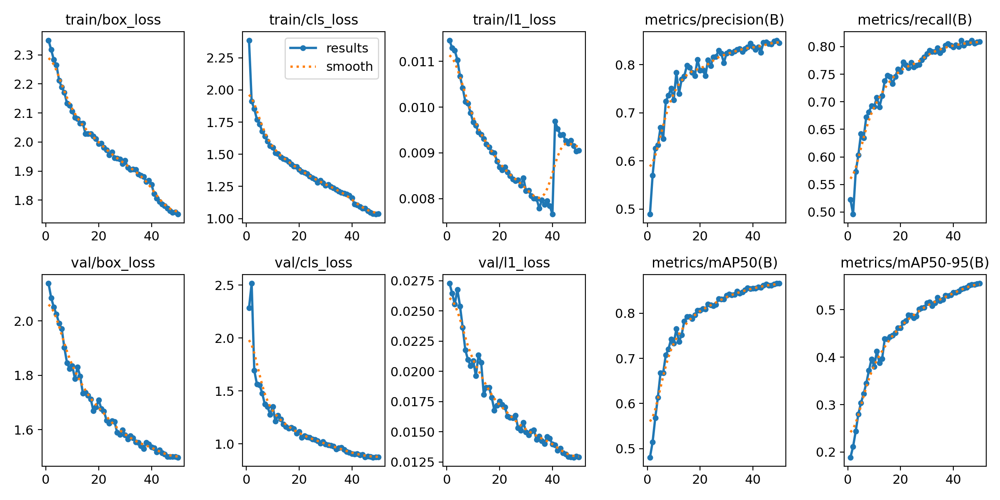
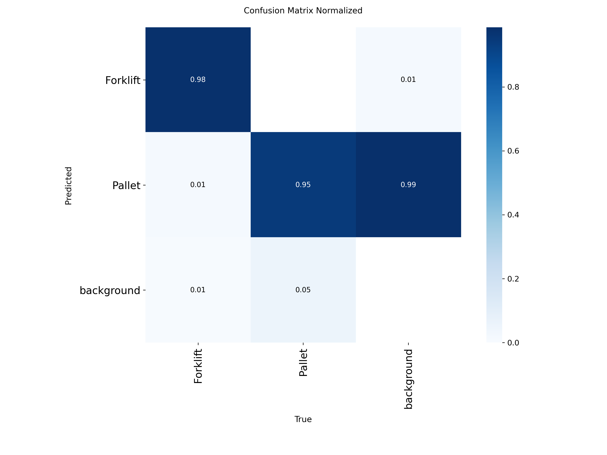
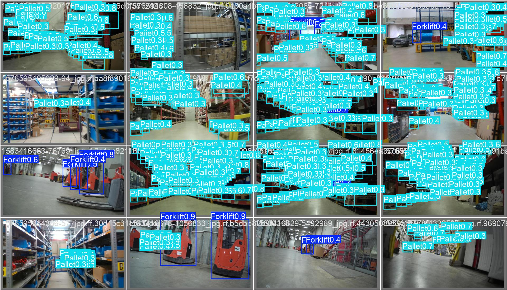

# Forklift & Pallet Detection

Real-time object detection for **Forklift** and **Pallet** in warehouse and logistics imagery.
Three public Roboflow datasets were merged into one two-class dataset, a YOLO26s model was fine-tuned on it,
and the model is served through a FastAPI service (with a small web UI) packaged for Docker.

| | |
|---|---|
| **Model** | Ultralytics YOLO26s (fine-tuned), 9.47 M parameters, 20.8 GFLOPs |
| **Classes** | `0 = Forklift`, `1 = Pallet` |
| **Validation mAP@0.5** | **0.866** (Forklift 0.965, Pallet 0.766) |
| **Validation mAP@0.5:0.95** | **0.556** (Forklift 0.745, Pallet 0.367) |
| **Test mAP@0.5** | **0.833** (Forklift 0.930, Pallet 0.736) |
| **Test mAP@0.5:0.95** | **0.531** (Forklift 0.718, Pallet 0.343) |
| **Inference speed** | 7.8-16.1 ms / image at 640 px on a Tesla T4 (model only, two separate runs) |

---

## 1. Results

Final model (`best.pt`), evaluated on the **validation split** (1,133 images, 17,127 instances):

| Class | Images | Instances | Precision | Recall | mAP@0.5 | mAP@0.5:0.95 |
|---|---|---|---|---|---|---|
| Forklift | 408 | 474 | 0.894 | 0.928 | 0.965 | 0.745 |
| Pallet | 766 | 16,653 | 0.799 | 0.690 | 0.766 | 0.367 |
| **All** | 1,133 | 17,127 | 0.847 | 0.809 | 0.866 | 0.556 |

Speed per image on a Tesla T4 (Ultralytics validation run): 0.2 ms preprocess, 16.1 ms inference, 1.1 ms postprocess.

Training ran for all 50 epochs (2.135 hours). Validation mAP@0.5 was flat at 0.866 over the last epochs, so the run had converged.

### Held-out test split

The same `best.pt` evaluated on the **test split** (870 images, 15,893 instances). The test split was not used for training or for choosing the checkpoint.

| Class | Images | Instances | Precision | Recall | mAP@0.5 | mAP@0.5:0.95 |
|---|---|---|---|---|---|---|
| Forklift | 291 | 332 | 0.883 | 0.904 | 0.930 | 0.718 |
| Pallet | 625 | 15,561 | 0.752 | 0.680 | 0.736 | 0.343 |
| **All** | 870 | 15,893 | 0.818 | 0.792 | 0.833 | 0.531 |

Speed per image on a Tesla T4 (test run): 0.8 ms preprocess, 7.8 ms inference, 3.2 ms postprocess. Timings differ between the two runs, so treat them as indicative.

Test scores are slightly lower than validation (mAP@0.5 0.833 vs 0.866, mAP@0.5:0.95 0.531 vs 0.556), which is expected because the checkpoint was selected on the validation split. The gap is small and the pattern is the same: Forklift is strong (mAP@0.5 0.93), while Pallet is weaker (recall 0.68, mAP@0.5:0.95 0.34). The validation and test splits come from the same source datasets, so they do not measure performance in new environments.







## 2. Data

### Sources
Three public Roboflow Universe datasets were combined into one Roboflow project and exported in YOLO format:

| Dataset | Original classes |
|---|---|
| [Pallet Detection](https://universe.roboflow.com/pallet-detection-8fzxc/pallet-detection-6pxud) | `Pallet` |
| [Forklift](https://universe.roboflow.com/paddog-eu-object/forklift-xitsb) | `forklift` |
| [LOCO](https://universe.roboflow.com/loco-fml/loco-fml) | `forklift`, `pallet`, `pallet_truck`, `small_load_carrier`, `stillage` |

The merged export had six classes: `Pallet`, `forklift`, `pallet`, `pallet_truck`, `small_load_carrier`, `stillage`.

### Class remapping
Class ids differ between datasets, so classes were remapped **by name, not by id**:

| Source class | Final class |
|---|---|
| `forklift` | **Forklift** (0) |
| `Pallet`, `pallet` | **Pallet** (1) |
| `pallet_truck`, `small_load_carrier`, `stillage` | dropped |

Labels of dropped classes were removed. Images left with no Forklift or Pallet were discarded (266 train, 27 val, 28 test). Polygon labels (if any) are converted to bounding boxes, and coordinates are clipped to [0, 1]. `pallet_truck` is deliberately **not** mapped to Forklift: a hand pallet truck is a different machine.

The labels were checked visually (boxes drawn on random images) before training.

### Final dataset

| Split | Images | Forklift boxes | Pallet boxes |
|---|---|---|---|
| train | 8,400 | 3,138 | 136,492 |
| val | 1,133 | 474 | 16,653 |
| test | 870 | 332 | 15,561 |

Notes:
- **Class imbalance:** about 1 Forklift box for every 43 Pallet boxes in training.
- **Dense scenes:** images that contain pallets average about 22 pallet boxes per image in validation (warehouse racks, stacked loads).
- The original Roboflow train split contains **augmented copies** (8,666 files generated from 6,080 distinct source filenames). Roboflow augmentation is applied after the split, so copies stay inside train.

---

## 3. Approach and design choices

- **YOLO (single-stage detector).** Fast enough for real-time video, simple to train, and easy to export and deploy (ONNX, TensorRT, OpenVINO).
- **Transfer learning.** Fine-tuning from COCO-pretrained weights, which already encode vehicles, boxes and structures, converges faster and generalises better on a limited domain dataset than training from scratch.
- **Small model size (YOLO26s).** A good accuracy/latency trade-off that can run on a modest local server. Larger variants or higher input resolution are the first options to try for the Pallet class.
- **One merged dataset, trained once.** An earlier attempt trained on one dataset and then continued on the others.
- **Per-class reporting.** Overall mAP hides the weaker class, so metrics are reported for each class.

### Training setup

| | |
|---|---|
| Framework | Ultralytics 8.4.176, PyTorch 2.11.0 (CUDA 12.8), Python 3.13 |
| Hardware | Kaggle, 1 × Tesla T4 (15 GB) |
| Pretrained weights | COCO-pretrained YOLO26s |
| Input size | 640 × 640 |
| Epochs | 50 (all completed) |
| Early stopping | patience 15 |
| Batch size | 8 (1,050 iterations per epoch over 8,400 images) |
| Seed | 42 |
| Peak GPU memory | about 4.5 GB |
| Training time | 2.135 hours |
| Other settings | Ultralytics defaults (optimizer, learning-rate schedule and on-the-fly augmentation such as mosaic, HSV jitter and flips); exact values are in `args.yaml` |

---

<!-- ## 4. Development process and lessons learned

1. **First attempt: LOCO only.** Results were poor.
2. **Sequential fine-tuning.** Continuing from those weights on the other two datasets gave very high validation scores (mAP@0.5 around 0.97), but the model failed on real images, especially pallets.
3. **Diagnosis.** Likely causes: (a) the validation set resembled the training set (frames from the same videos), inflating the scores; (b) training sequentially can make the model forget what it learned earlier (catastrophic forgetting).
4. **Revised pipeline.** Merge everything into a single dataset with name-based class remapping, drop unneeded classes, verify the labels visually, train once from COCO weights, report per-class metrics, and evaluate on separate data.
5. **Result.** Lower but more realistic scores, and a clear view of the weak spot: the Pallet class. -->

---

## 4. Deployment

The model is served by a FastAPI app.

| Endpoint | Description |
|---|---|
| `GET /` | Web UI: upload an image, preview it, press *Detect* to see boxes, labels and per-class counts |
| `POST /predict` | Multipart upload (`file`, optional query `conf`, default 0.25). Returns `count` and `detections` (`class`, `confidence`, `bbox` in xyxy pixels) |
| `GET /health` | Health check |
| `GET /docs` | Interactive Swagger UI |

- `webcam.py`: live detection from a camera, a video file or a stream URL.

This script uses `device="mps"` (Apple Silicon GPU). On other machines change it to `"cpu"` or `0` (CUDA).

### Project structure
```
.
├── app.py              # FastAPI service
├── index.html          # web UI served at /
├── webcam.py           # real-time camera inference
├── requirements.txt
├── weights/
│   └── best.pt         # trained model
└── images/             # result plots used in this README
```

<!-- ## 6. Assumptions and limitations

- **Pallet class is the weak point.** Recall is 0.69 (about 31% of pallets are missed) and mAP@0.5:0.95 is 0.37, so boxes are often loose. Validation images are crowded scenes with many small, adjacent and stacked pallets.
- **Annotation consistency across sources is assumed, not verified.** Datasets may differ in what a "pallet" box covers (the wood only, or the load on top, or a whole stack), which limits box accuracy.
- **Partially labelled sources.** Some datasets were labelled for only one class, so unlabelled forklifts or pallets may appear in the others and be treated as background. Objects of the dropped classes (pallet trucks, stillages, small load carriers) are also treated as background.
- **Class imbalance** (about 1:43 Forklift to Pallet boxes) can bias the model. It was not corrected by resampling or loss weighting.
- **Possible train/validation overlap.** The data includes video frames and augmented copies. The split was inherited from the sources, and a content-hash overlap check between splits is _TBD_.
- **Checkpoint selection on validation data** makes validation scores slightly optimistic (see Section 1).
- **Domain gap.** Public datasets are mostly indoor warehouses. Performance on oil and gas sites (outdoor yards, dust, night, different equipment and camera heights) is untested.
- **Not evaluated:** heavy occlusion, very small or distant objects, and latency on the target deployment hardware. Only the model inference time on a T4 is reported.
- **Dataset licences** were not reviewed here and should be checked before any commercial use.
- The API has no authentication, request validation beyond the basics, or batching. It is a prototype, not a production service.

## 7. Future work

- Evaluate on the held-out test split and on independently collected site images; analyse failure cases.
- Improve the Pallet class: higher input resolution (e.g. 960), a larger model, consistent re-annotation, and resampling for the Forklift class.
- Collect and label data from the target environment and fine-tune on it.
- Export to ONNX / TensorRT for faster inference; add object tracking for counting.
- Production hardening: authentication, input validation, logging, monitoring for data drift, model and data versioning (MLflow / DVC), CI/CD, and cloud deployment of the same Docker image. -->